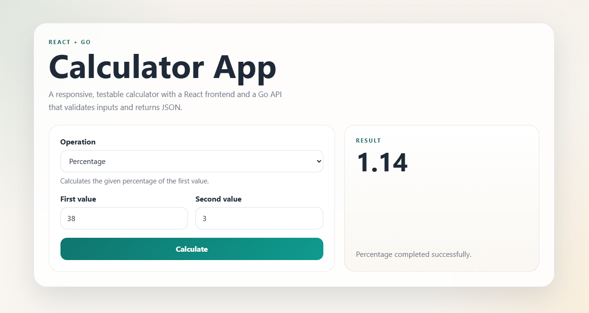

# Calculator App

Full-stack calculator built with a React + TypeScript frontend and a Go backend API.

The project supports addition, subtraction, multiplication, division, exponentiation, square root, and percentage calculations. The frontend validates inputs before sending requests, while the backend performs the final validation and returns JSON responses.

## Preview



## Setup Instructions

### Prerequisites

- Node.js 20+
- npm 10+
- Go 1.27+

On Windows, Go was installed to `C:\Program Files\Go\bin\go.exe`.

### Install dependencies

```powershell
cd backend
go test ./...
```

```powershell
cd frontend
npm install
```

## How to Run the Backend

```powershell
cd backend
go run ./cmd/api
```

The API listens on `http://localhost:8080` by default.

Run backend tests and coverage with:

```powershell
cd backend
go test ./... -coverprofile=coverage.out
go tool cover -html=coverage.out
```

## How to Run the Frontend

```powershell
cd frontend
npm run dev
```

The app runs on `http://localhost:5173` and proxies API requests to the backend during development.

Run frontend tests and coverage with:

```powershell
cd frontend
npm run test:coverage
```

## REST API Examples

### Health check

```http
GET /healthz
```

Response:

```json
{ "status": "ok" }
```

### Calculate

```http
POST /api/calculate
Content-Type: application/json
```

Addition:

```json
{ "operation": "add", "left": 7, "right": 5 }
```

Subtraction:

```json
{ "operation": "subtract", "left": 10, "right": 3 }
```

Multiplication:

```json
{ "operation": "multiply", "left": 6, "right": 8 }
```

Division:

```json
{ "operation": "divide", "left": 20, "right": 4 }
```

Exponentiation:

```json
{ "operation": "power", "left": 2, "right": 8 }
```

Square root:

```json
{ "operation": "sqrt", "left": 81 }
```

Percentage:

```json
{ "operation": "percentage", "left": 200, "right": 15 }
```

Success response:

```json
{ "result": 12 }
```

Error response:

```json
{ "error": "division by zero" }
```

## Design Decisions and Assumptions

- The backend uses only the Go standard library to keep the service small, portable, and easy to audit.
- The calculator rules live outside the HTTP handler so they can be unit-tested without HTTP fixtures.
- The frontend uses a single API client module and a small component set to keep state management predictable.
- CORS is restricted to the local frontend origins used by the development and Docker setups.
- Advanced operations are supported in the frontend UI, but the API remains generic and driven by the `operation` field.
- The percentage operation is implemented as `left * right / 100`.
- The square root operation uses only the `left` operand.

## Project Structure

This repository uses a small layered layout to keep the codebase easy to test and evolve:

- `backend/cmd/api` for the HTTP entrypoint
- `backend/internal/calculator` for arithmetic rules and validation
- `backend/internal/httpapi` for transport concerns and JSON handling
- `frontend/src/api` for API calls
- `frontend/src/components` for UI composition

That separation keeps business logic independent from the HTTP layer and makes both layers easier to test.

## Docker

```powershell
docker compose up --build
```

Services:

- Frontend: `http://localhost:5173`
- Backend: `http://localhost:8080`
